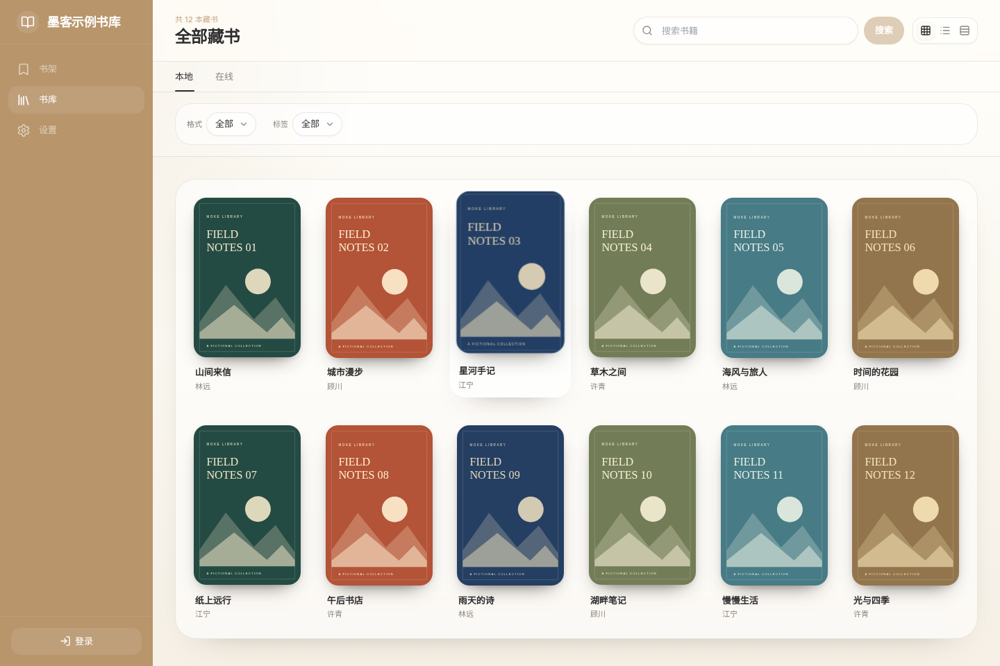
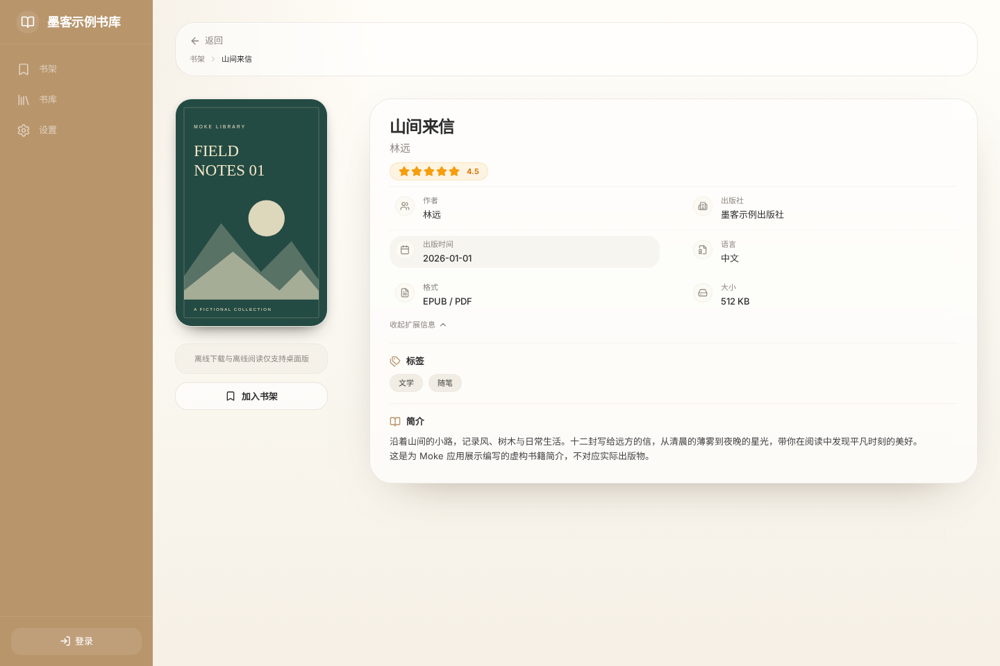

<div align="center">
  
  <h1>Moke · 墨客</h1>
  <p>连接你的 Talebook 书库，让阅读触手可及。</p>
  <p>
    <a href="https://github.com/talebook/moke/releases"></a>
    <a href="https://github.com/talebook/moke/actions/workflows/ci.yml"></a>
    <a href="LICENSE"></a>
  </p>
  <p>
    <a href="https://github.com/talebook/moke/releases">稳定版下载</a> ·
    <a href="#moke-preview-赞助内测">Moke Preview</a> ·
    <a href="#快速开始">快速开始</a> ·
    <a href="https://github.com/talebook/moke/issues">问题反馈</a> ·
    <a href="CONTRIBUTING.md">参与贡献</a>
  </p>
</div>

**Moke** 是为 [Talebook](https://github.com/talebook/talebook) 自托管电子书服务器打造的开源客户端，基于 Next.js、React 和 Tauri 构建，提供桌面与移动平台安装包。你可以浏览、搜索自己的书库，下载书籍离线阅读，或通过内嵌的 [readest-reader](https://github.com/hehetoshang/readest-reader) 在线阅读 EPUB。

> 使用前请准备一个可访问的 Talebook 服务器。Moke 是客户端，书库管理与账号服务由 Talebook 提供。

[应用预览](#应用预览) · [主要功能](#主要功能) · [安装](#安装) · [Moke Preview](#moke-preview-赞助内测) · [快速开始](#快速开始) · [本地开发](#本地开发) · [贡献与反馈](#贡献与反馈) · [许可证](#许可证)

## 应用预览

### 桌面书库



<details>
  <summary>查看书籍详情与移动端书库</summary>

### 书籍详情



### 移动端书库


</details>

截图来自当前代码的 Web 开发预览，使用虚构书库与原创示例封面；原生应用的窗口和可用操作可能有所不同。[截图来源与更新方法](docs/screenshots/README.md)。

## 主要功能

- **浏览与搜索**：按分类、标签、作者、出版商浏览书库，检索书名、作者与简介。
- **多种视图**：在封面网格、列表和桌面表格之间切换，查看书籍详情。
- **离线阅读**：将书籍下载到本地，在书架中打开已下载的书籍。
- **内嵌阅读器**：集成 readest-reader，支持 EPUB、PDF 等多种格式。
- **漫画阅读**：按服务端书籍类型打开 Talebook 同款漫画阅读器，在线支持 CBZ/ZIP/CBR/RAR，保存并恢复页码；[格式与离线限制](docs/COMIC_READING.md)。
- **在线 EPUB**：通过 Talebook 授权的 Range 接口按需读取，无需先下载整本书。
- **局域网连接**：支持纯 HTTP 与自签名 HTTPS 的自托管服务器。
- **账号与访问控制**：支持访问码、登录和注册，遵循服务器权限设置。
- **墨水屏模式**：提供高对比度界面，减少阴影与装饰效果。

应用内置一本约 2 KB 的原创示例 EPUB，默认不导入。在「关于」页面连续点击版本号 8 次解锁开发者选项后，可在「设置 → 开发者选项 → 示例书籍」手动导入，并进入离线书库体验阅读。导入后同一按钮变为「删除示例书籍」，删除后可重新导入。

## 安装

公开稳定版免费提供，前往 [GitHub Releases](https://github.com/talebook/moke/releases) 下载适合设备的安装包，具体可用平台以对应版本的发布资产为准。

| 平台 | 安装包格式 |
|---|---|
| Windows | `.msi` / `.exe` |
| macOS | `.dmg` |
| Linux | `.AppImage` / `.deb` |
| Android | `.apk` |
| iOS/iPadOS | `.ipa`（自签名安装，需将设备 UDID 加入开发者描述文件） |
| OpenHarmony（鸿蒙） | `.hap`（alpha，未签名，可能需要自签名安装） |

> **系统要求**：Windows 10 1809+ / macOS 11+ / Linux（glibc 2.31+）/ Android 8+ / iOS/iPadOS 17+ / HarmonyOS NEXT 5.0+（API 12）

OpenHarmony 安装包目前处于 alpha 阶段，建议在测试设备上体验；iOS/iPadOS 和 OpenHarmony 的签名、安装要求见对应版本的发布说明。

### Moke Preview 赞助内测

[Moke Preview](https://github.com/hehetoshang/moke-preview-builds) 是面向希望提前体验新功能并参与反馈的赞助者的预览通道。安装包与发布说明在独立仓库提供，具体可用平台及安装要求以对应版本的发布说明为准。

1. 前往 [爱发电](https://ifdian.net/a/hehetoshang) 选择包含 Moke Preview 资格的内测方案，从私信获取一次性访问码及安装说明。
2. 从 [Preview Releases](https://github.com/hehetoshang/moke-preview-builds/releases) 下载适合设备的安装包。
3. 首次启动时输入访问码，完成当前设备的激活；后续启动需要联网检查授权。更换或重装设备时，请按应用提示迁移资格。

普通赞助不代表自动获得 Preview 资格，具体权益以爱发电方案说明为准。目前 Preview 安装包未启用自动更新，更新时请前往 Preview Releases 下载新版本并按发布说明安装。

Preview 可能包含未完成的功能或兼容性问题，请提前备份重要数据。参与方式、设备迁移与安装详情见 [Preview 仓库说明](https://github.com/hehetoshang/moke-preview-builds#readme)。

遇到问题或有体验建议时，可使用 [Moke Preview 专用反馈表单](https://github.com/talebook/moke/issues/new?template=moke-preview.yml&labels=moke-preview)。访问码或订单问题请通过爱发电私信联系开发者，请勿在公开 Issue 中提交访问码、订单凭证、账号密码或服务器密钥。

## 快速开始

1. **保存服务器**：启动后进入「服务器」列表，点击「加入服务器」，输入 Talebook 根地址并「保存到列表」。可继续保存 A、B 等多个服务器；保存只校验地址格式，不连接服务器，列表在重启后保留。
2. **从列表连接**：点击已保存条目，直接使用该地址连接；按服务器配置输入访问码或登录账号。连接失败、超时或取消不会删除列表，也不会替换原连接。
3. **切换与断开**：从桌面侧栏或移动端「我的 → 设置」进入「服务器列表」，点击另一条目。请先关闭 Reader 及 Reader 书库窗口；窗口仍打开时会保留原连接并提示重试。「断开」只结束连接，保留已保存条目。
4. **浏览与阅读**：打开「书库」搜索、筛选书籍。在原生书籍详情页选择「在线阅读」，或「下载后阅读」；已下载的文件仍可离线打开。

旧单服务器配置会在本地迁移一次。地址按 HTTP(S) origin 去重，拒绝账号、非根路径、查询参数和片段；不同协议或非默认端口分别保存。加载或保存失败会明确提示，不报保存成功；坏配置可通过「保留原数据并重建列表」恢复，可读取的原配置会先备份，已有离线文件保留。Web 使用 localStorage；原生版本使用 AppData/books/.servers 中的原子 JSON 文件并读回校验。

服务器列表读取超过 8 秒会显示超时说明，并提供“先使用离线书库”；已有连接也可点击“返回当前书架”。这些入口保留原数据，不启动新的列表读取或重建。原读取结束前，列表保存、重新加载和恢复仍锁定，避免迟到迁移覆盖数据；原读取完成后列表自动恢复，离线页面和当前连接继续保留。也可完全退出并重新启动应用后重试。连接后获取的服务器名称会写入对应条目并读回校验；名称保存失败会提示且保留当前连接，列表原名称不变，可重新连接重试。

“先使用离线书库”进入 `/library`，可查看包括未加入书架的本地下载。单 WebView 平台从这里打开下载书籍后，关闭 Reader 会按离线阅读的返回约定进入 `/shelf`，不会恢复打开前的书库筛选或详情页；这与普通“进入离线模式”的书架落点一致。示例书入口的离线书库跳转凭据只用于首次进入 `/library`，后续关闭 Reader 同样返回离线书架。

Reader 返回书库时若列表读取超时，会留在当前页面等待原读取完成；也可点击“返回服务器列表”明确放弃这次返回。等待期间不会提前消耗一次性返回凭据。

单条配置无效或重复时，列表会跳过该条并提示数量，其余服务器仍可连接，读取不会改写原配置；后续保存或更新名称前会先备份原配置并校验。外层格式损坏仍需恢复。恢复失败时请在浏览器站点设置或系统设置允许本应用使用存储、检查可用空间，再完全退出重启后重试。

旧单服务器地址无效时也会跳过并提示，可直接加入新服务器，无需清空原数据；读取保留原配置和兼容地址字节，后续保存前先备份并校验。`null`、`undefined` 等缺失值字面量不作为服务器，合法的局域网短主机名仍受支持。

保存或更新名称时发现其他窗口已更改配置，服务器列表会提供“重试加载”。外部修改可能删除条目或改变条目对应的服务器，因此必须重新加载最新列表，才能发起新的连接；当前连接和账号仍保留，加载后可重新保存。普通写入权限失败不会触发这个冲突限制，已读取的有效列表仍可连接。写入在备份后再次核对原始配置，但读取与写入不是原子操作，不能保证跨进程同时写入绝无竞争。损坏的兼容地址镜像在更新或断开清除前也会先备份原字节并校验，备份失败保留原值，并在开发者日志记录不含地址或账号数据的警告；镜像失败不影响连接、断开或已保存列表。

离线模式和当前连接只保留在运行时，冷启动只加载列表，不自动重连，也不会自动回到离线书库。纯离线使用者重新启动后会停在服务器列表，需再次选择离线入口；已下载文件仍保留。已保存的有效列表即使变为只读也可连接，新增条目仍须写入并校验成功；首次创建或旧配置迁移写入失败时需先恢复存储。恢复成功会断开原连接。访问码页刷新后可按已保存服务器 ID 重建候选请求，不复用旧请求编号。

当前会话从在线进入离线后，可通过侧栏或设置的“连接服务器”恢复此前服务器；恢复会重新确认访问码和账号，失败或取消时继续保留离线书库。当前会话没有此前连接时，该入口返回服务器列表供明确选择。

单 WebView 的示例书“在离线书库查看”入口使用一次性会话凭据跨文档传递离线意图，不携带服务器身份或账号，不持久化离线模式；到达 `/library` 后消费，刷新、历史返回或重新启动不会重新激活。重新连接后会重新探测服务端能力；能力结果仅在当前运行时缓存，冷启动不恢复旧能力快照。

原生服务器列表位于 `AppData/books/.servers`，只包含地址、标题和时间戳等元数据；Reader 可通过现有文件读取/asset 作用域读取此目录，它不提供主窗口专属的保密隔离，写入仍限于主窗口。迁移备份使用固定文件名；损坏配置在覆盖前备份并校验，成功写入后不重复备份；恢复另存唯一备份。服务器列表提供“查看本次会话最新备份”，只读展示再次核对过的原始内容和存储位置：原生为 `AppData/books/.servers/<备份键>.json`，Web 为当前站点的 localStorage 备份键。查看不恢复配置或改变连接；备份被删除、修改或不可读时会提示失败。本入口只记录本次会话中注册表迁移、容错保存或恢复生成的最新备份，不列举历史文件或兼容地址镜像的独立备份。为保留排障原数据，暂不自动轮转删除，多次损坏/恢复会累积文件；可在确认恢复完成后通过系统文件管理器维护原生历史备份，Web 历史备份可在浏览器开发者工具的当前站点存储中查看。

登录、注册和重置密码页在冷启动或刷新后若没有当前连接，会显示返回服务器列表的提示并禁用提交；请重新连接后再进行账号操作。同一服务器的登录身份改变时，也会清理页面状态与原身份的数据。

服务器列表不保存账号凭据。Cookie 仍由浏览器或原生 HTTP 传输层管理；同主机不同端口不构成 Cookie 隔离边界。下载、重试和阅读进度使用各自的来源服务器地址。

桌面阅读进度仅为经 Moke 打开的、已绑定来源的 Reader 窗口同步。从 Reader 内置书库打开的书暂不向 Talebook 同步进度；无法确认来源时会在开发者日志记录窗口与书籍编号。连接验证失败直接返回，不自动重试，可再次点击条目重试。

连接切换或开书前的阅读进度同步最多等待 8 秒；失败或超时后继续操作，并在开发者日志记录诊断。超时会取消传输，但无法撤回服务器已接受的进度保存。

若派发开书后观察到多个新 Reader 窗口，无法确认来源会提示完全退出重启；即使随后窗口列表变空，也不能证明尚未确认的派发请求不会迟到创建窗口，因此不自动解除来源保护。桌面和移动主窗口均显式使用 `main` label；宿主进度事件发送失败保留 Rust warning，但不把旁路事件失败改成 Reader 开书失败。


在线阅读要求 Talebook 提供 `talebook.reader.bootstrap.v1` 与逐书授权的 `/read/resource/<id>.epub?revision=...` 接口。Moke 会拒绝跨服务器资源、重定向、异常 MIME、缺失 Range/ETag 及资源版本变化，不会把 Cookie 或 Token 放入书籍 URL。

在线 EPUB 按需读取，不会自动加入离线书库。服务器不支持在线阅读接口、权限失效或网络异常时，可以重试，或明确选择下载后阅读。在线阅读的接口要求和兼容性说明见 [Reader 集成文档](docs/reader-development.md#在线阅读兼容性)。

## 本地开发

推荐使用 **Node.js 24**（与 CI 一致）和 **pnpm 9.15.9**（由 `package.json` 固定）。运行桌面应用还需要 Rust 工具链和 [Tauri 系统依赖](https://v2.tauri.app/start/prerequisites/)。

Node.js 最低版本为 **22.15.0**。`pnpm test` 使用内置 TypeScript 类型剥离和 `node:module` 的同步 `registerHooks` API；Node.js 20 不支持这套测试工具。CI 使用 Node.js 24。

### Web 界面开发

浏览器兼容目标为 Chrome 96+；实际旧浏览器验收范围和回归步骤见
[浏览器兼容性](docs/browser-compatibility.md)。

只开发 Moke 的书库与设置界面时，可以先启动 Web 预览：

```bash
git clone https://github.com/talebook/moke.git
cd moke
pnpm install --frozen-lockfile
pnpm dev-web
```

打开 <http://localhost:3000>。Web 预览用于界面开发，原生文件访问、离线阅读和内嵌 Reader 联调需要完整应用环境；连接真实服务器时还需满足浏览器的跨域访问要求。

### Reader 开发与构建

完整应用需要初始化递归子模块并安装 Reader 依赖，详见 [Reader 开发与构建](docs/reader-development.md)。完成准备后：

```bash
git submodule sync --recursive
git submodule update --init --recursive
cd readest
pnpm install --frozen-lockfile
pnpm setup:vendors
cd ..
```

然后使用以下命令：

| 命令 | 用途 |
|---|---|
| `pnpm tauri dev` | 启动桌面应用，同时启动 Moke 与 Reader 开发服务 |
| `pnpm tauri build` | 构建生产安装包，自动构建并复制 Reader 资源 |
| `pnpm lint` | 检查 ESLint 规则 |
| `pnpm typecheck` | 检查 TypeScript 类型 |
| `pnpm test` | 运行 API、离线存储和平台分支等测试 |

服务器列表 Web 回归（另一个终端先启动 `pnpm dev-web --port 3000`）：

```bash
pnpm exec playwright test tests/server-list.spec.mjs
# 使用系统 Chromium 时可指定 MOKE_TEST_CHROMIUM_PATH=/path/to/chromium
```

这些测试使用虚构 A/B 网络响应和实际浏览器存储，覆盖 PC/移动列表、保存/连接分离、迁移、失败/取消/重试和认证切换；不能替代真实原生重启、Reader 或 Cookie/CORS 验证。

测试前至少执行 `git submodule update --init readest`，Reader 契约测试会读取子模块内容。详细的环境准备、代码规范和提交流程见 [贡献指南](CONTRIBUTING.md)。

## OpenHarmony 开发命令

`pnpm tauri ohos ...` 暂时使用 `vendor/tauri` 固定的
`hehetoshang/tauri:app-name-fix`（`8269cb2d`）源码编译并运行 CLI。
该分支基于官方 `feat/open-harmony`，修复了生成工程的应用名称和图标，
对应上游 [PR #16151](https://github.com/tauri-apps/tauri/pull/16151)。
首次执行需要 Rust 工具链并会编译 CLI。npm 发布版 CLI
不提供 `ohos` 子命令，其他平台命令仍使用 npm CLI。
CLI 使用官方支持的 `rustls` feature 和内置 CA 根证书，避开当前锁定版本的
`platform-certs` 编译错误；TLS 校验仍然启用，但不会读取系统自定义 CA。

本次官方分支迁移的 Rust 插件兼容层已通过完整 OHOS target check 和
`ohrs build --arch arm64`，但 HAP 组装、安装和设备运行仍待验证。完整状态见
[OHOS 验证记录](docs/ohos-upstream-validation.md)。配置 OHOS SDK、`ohpm`、
Hvigor 和签名后，开发命令为：

```bash
pnpm tauri ohos init
hdc tconn 127.0.0.1:5555
pnpm tauri ohos dev --host 10.0.2.2
pnpm tauri ohos build --target aarch64
```

OpenHarmony 使用独立包名 `org.houheya.moke_openharmony`；`pnpm tauri ohos init/build`
会加载 `src-tauri/tauri.ohos.conf.json`。直接调用 `cargo tauri ohos build` 时需显式传入
`--config src-tauri/tauri.ohos.conf.json`。

`10.0.2.2` 是当前 QEMU 用户网络访问宿主机的地址。dev 包依赖开发服务器，
单独启动旧 dev 包出现白屏不能作为新版本运行失败的结论。验收必须使用当前
提交重新构建安装的包，并同时验证开发服务器、Tauri IPC 和阅读流程。

## 贡献与反馈

- [报告 Bug 或提出建议](https://github.com/talebook/moke/issues)：请附上应用版本、系统环境与复现步骤。
- [反馈 Moke Preview 问题](https://github.com/talebook/moke/issues/new?template=moke-preview.yml&labels=moke-preview)：请使用专用表单，并附上 Preview 版本、运行平台与复现步骤。
- [参与贡献](CONTRIBUTING.md)：了解开发流程与提交规范。
- [安全政策](SECURITY.md)：安全漏洞请通过私密渠道报告。
- [隐私政策](PRIVACY.md)：了解应用的数据处理方式。

## 相关项目

- [Talebook](https://github.com/talebook/talebook)：自托管电子书服务端，提供书库与账号服务。
- [readest-reader](https://github.com/hehetoshang/readest-reader)：从 Readest 抽离、按 `moke.readest.embed.v1` 契约集成的阅读器。

## 开发者

- **houheya**（[@hehetoshang](https://github.com/hehetoshang)）— Moke 客户端开发

## 致谢

- **Rex**（[@talebook](https://github.com/talebook)）— Talebook 服务器作者，Moke 项目指导者

## 支持

如果 Moke 对你有帮助，欢迎请维护者喝杯咖啡~

<div align="center">
  <table>
    <tr>
      <td align="center"><br/>微信</td>
      <td align="center"><br/>支付宝</td>
    </tr>
  </table>
</div>

### 感谢以下用户的打赏支持

- 金海先生
- 千成

## 说明

本项目部分代码由 AI 编程工具（Codex、cc-haha、multica-agent）辅助生成，所有代码均经过人工审查。

## 许可证

Moke 使用 [GNU General Public License v3.0](LICENSE) 许可证。
